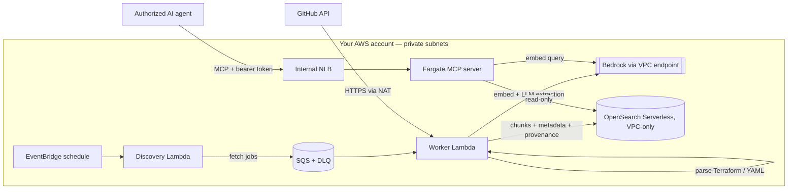

<h1 align="center">Aquifer — Engineering Context for AI Agents</h1>

<p align="center">
  
</p>

<p align="center"><b>Give AI coding agents reliable, source-backed engineering context before they change your systems.</b></p>

Aquifer is a self-hosted, **source-available** retrieval layer that coding agents query over the
**Model Context Protocol (MCP)**. It ingests engineering sources (GitHub today), extracts the
entities and relationships those sources state, and answers questions like *"what depends on
`billing-api`, and where is that defined?"* with **facts plus their evidence**: repository,
file path, commit, line range and timestamps — and how each fact was obtained.

```text
# abbreviated find_related output on the demo repositories (deployed, LLM extraction enabled)
agent> find_related("billing-api", direction="incoming")

orders-service  depends_on  billing-api      explicit_reference   2 sources
  acme/platform  docker-compose.yml  L6   @a81b5c0   https://github.com/acme/platform/blob/a81b5c0…/docker-compose.yml#L6
  acme/platform  catalog-info.yaml   L10  @a81b5c0   …
checkout-service depends_on billing-api      llm_extracted, grounded (text match)
  acme/payments  issue #12           L2   updated 2024-06-05
```

It runs in **your** AWS account (a single CDK stack) or entirely on your laptop with no AWS at
all (local mode).

## What Aquifer does — and does not do

| Aquifer does | Aquifer does not |
| --- | --- |
| Retrieve engineering context by meaning (vector search) and by fact (entities/relationships) | Decide whether a change is safe, rank risk, or recommend actions |
| Parse explicit references from Terraform, docker-compose and Backstage descriptors, with exact lines | Claim to know every dependency of your system |
| Use an LLM (your own Bedrock) to extract relationships from prose, and label them as such | Present model-extracted facts as verified |
| Tell the agent when there is **no evidence** for an answer | Treat "no result" as proof that something does not exist |
| Track where and when each fact was read (revision, source time, index time) | Promise the index is current with the source at every moment |

**Neutral by design.** Agents are the users. Aquifer organizes facts and their provenance; the
agent does the reasoning. There are no scores, verdicts or "should" anywhere in the responses.

**Not a developer portal.** There is no UI and no catalog to curate. Aquifer reads what your
repositories already say (including Backstage descriptors, if you have them) and exposes it to
agents through a small, stable tool API.

## MCP tools

All five tools are read-only. Every result carries `evidence` (repository, path, revision,
line range, permalink) and freshness fields where the source provides them; fields that are not
known are omitted or `null`, never guessed.

| Tool | Purpose |
| --- | --- |
| `search_context(query, k?, filters?)` | Semantic search; ranked chunks with evidence and freshness |
| `find_related(entity, relationship_types?, k?, repo?, direction?)` | Relationships to/from an entity, each with origin (`explicit_reference` / `llm_extracted`), support counts and evidence; distinct same-name candidates are listed, never merged; `evidence_status` says when nothing supports an answer |
| `get_document(document_id, line_start?, line_end?)` | The exact source text, provenance, and an optional line-range excerpt to open evidence |
| `list_entities(document_id?, entity_type?, k?, repo?)` | Inventory of distinct entities with document counts |
| `list_sources()` | Configured repositories with indexed document counts and last index time |

Details: [docs/concepts.md](docs/concepts.md). Connecting Claude Code, Cursor or another MCP
client: [docs/agent-integration.md](docs/agent-integration.md).

## Try it in two minutes (no AWS)

```bash
git clone https://github.com/Senora-dev/aquifer-ai.git && cd aquifer-ai
python -m venv .venv && source .venv/bin/activate && pip install -e ".[dev]"

python -m aquifer.local ingest examples/demo/repos          # three synthetic repositories
claude mcp add aquifer -- "$PWD/.venv/bin/python" -m aquifer.local serve \
  --store "$PWD/.aquifer-local/index.json" --repos-root "$PWD/examples/demo/repos"
```

Then ask your agent *"What depends on billing-api, and where is that defined?"*. The guided
three-minute demo is in [examples/demo/README.md](examples/demo/README.md). Local mode uses a
lexical (non-semantic) embedder and no LLM, so it shows the deterministic, explicit-reference
path; see [docs/getting-started.md](docs/getting-started.md).

## How data flows



1. **Fetch.** The GitHub connector reads READMEs, issues, pull requests and selected files
   (Terraform, docker-compose, Backstage descriptors, ADRs) from a pinned commit of the default
   branch. Unchanged content is skipped by content hash.
2. **Extract.** Deterministic parsers produce `explicit_reference` facts with exact lines. An
   LLM on your Bedrock extracts relationships from prose; each is checked against the text and
   marked `grounded` or not.
3. **Index.** Chunks (exact source slices with line ranges) are embedded and written to
   OpenSearch Serverless. Updates write a new generation before removing the old one; deleted
   files, removed READMEs and de-listed repositories are removed from the index.
4. **Retrieve.** Agents call the MCP tools with a bearer token. Every call is authorized,
   scoped to the configured repositories, and audit-logged.

## What stays in your infrastructure

- Source content, embeddings, extracted metadata and the index live in your account
  (OpenSearch Serverless reachable only through a VPC endpoint).
- Embedding and extraction run on Amazon Bedrock **in the stack's region**, reached through a
  VPC interface endpoint. If you configure a *cross-region inference profile* as the extraction
  model (e.g. `us.anthropic…`), Bedrock may process requests in other regions of that geography.
- There is no Aquifer-operated backend, telemetry, or license server.

**Network dependencies:** outbound HTTPS to `api.github.com` (through the NAT gateway), and
to ECR and CloudWatch Logs (also through NAT, to avoid extra endpoint costs). Application
security groups allow outbound TCP 443 only. The MCP endpoint is an internal load balancer —
it is never exposed to the internet.

## Permissions model

Aquifer enforces **one trust domain**: every valid MCP token can read every repository in the
configured allowlist, and nothing else. Concretely:

- MCP requests require `Authorization: Bearer <token>`; tokens live in Secrets Manager.
- All tools pass through the interceptor seam (`authorize`, `before_query`, `after_query`) and a
  core repository scope, so results from outside the allowlist are never returned.
- Aquifer does **not** mirror GitHub's per-user permissions. Only configure repositories that
  everyone holding a token may read. Per-principal rules can be added with an interceptor.

See [docs/security.md](docs/security.md) for the full model, prompt-injection handling and
limitations.

## Sources supported

GitHub: READMEs, issues, pull requests (with merged/open state), and repository files matching
configurable globs. Deterministic extraction: Terraform (`.tf`), docker-compose, Backstage
`catalog-info.yaml`. Other connectors can be added through the `Connector` interface
([docs/contributing.md](docs/contributing.md)).

## Deploying to AWS, and what it costs

```bash
pip install -e ".[dev,cdk]" && npm install -g aws-cdk
python scripts/preflight.py --region eu-west-1 --repos your-org/your-repo   # read-only checks
cd infrastructure && cdk bootstrap && cdk deploy -c repos='["your-org/your-repo"]'
```

Full guide: [docs/deployment.md](docs/deployment.md). Operations, observability, uninstall and
troubleshooting: [docs/operations.md](docs/operations.md).

**Idle cost is dominated by OpenSearch Serverless**, which bills a minimum of 2 OCUs while the
collection exists (1 OCU with `-c aoss_standby_replicas=DISABLED`). At $0.24/OCU-hour (us-east-1)
that is about **$350/month** (or ~$175 for dev/test) before any traffic. NAT gateway, VPC
endpoints, the NLB and one small Fargate task add roughly $130/month. Bedrock is usage-based. See
[docs/operations.md](docs/operations.md#cost) for the breakdown.

## Current limitations

- One trust domain per deployment; no per-user source permissions.
- GitHub only. Deleted or transferred issues/PRs are not detected (GitHub's incremental API does
  not report deletions); deleted files, removed READMEs and de-listed repositories are.
- File provenance is the commit at which the file was read; issue/PR bodies have no revision
  (their `updated_at` is reported instead).
- LLM-extracted relationships are only checked for a textual mention of the target, not verified.
- The MCP listener is plain TCP inside the VPC unless you pass an ACM certificate
  (`-c mcp_certificate_arn=…`).
- The benchmark corpus is small and synthetic; it verifies behavior, not real-world accuracy.

## Measuring retrieval quality

```bash
python scripts/benchmark_retrieval.py --out report.json      # offline, deterministic, in CI
python scripts/benchmark_retrieval.py --bedrock              # with your Bedrock (costs money)
```

45 scenario cases (dependencies, Terraform module references, ADRs, similar names, stale and
deleted sources, missing evidence, repository isolation). Results and caveats:
[docs/benchmark.md](docs/benchmark.md).

## Project layout

```
src/aquifer/        core, connectors, extractors, vector stores, ingestion Lambdas, MCP server,
                    local mode, benchmark
infrastructure/     AWS CDK (Python) — the single deployable stack
scripts/            preflight checks, retrieval benchmark, LLM extraction eval
tests/              offline tests (incl. CDK synth), benchmark cases, extraction golden data
examples/           synthetic demo repositories and MCP client configs
docs/               architecture, concepts, deployment, operations, security, integration
```

## Contributing

Everything can be developed and tested without AWS credentials — see
[CONTRIBUTING.md](CONTRIBUTING.md). Security reports: [SECURITY.md](SECURITY.md). Changes:
[CHANGELOG.md](CHANGELOG.md).

## License

Aquifer is **source-available** under the **Business Source License 1.1** — see
[`LICENSE`](LICENSE) and [`LICENSE_TERMS.md`](LICENSE_TERMS.md). It is not an OSI-approved open
source license. The Additional Use Grant permits use, modification and distribution for any
internal purpose, provided you do not offer it to third parties as a managed service. It
converts to the Apache License 2.0 on the Change Date stated in `LICENSE` (2029-05-31).
