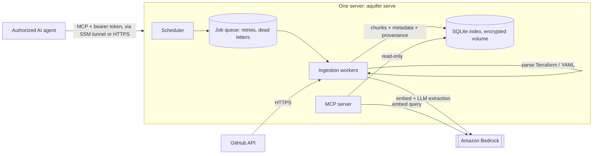

<h1 align="center">Aquifer — Engineering Context for AI Agents</h1>

<p align="center">
  
</p>

<p align="center"><b>Give AI coding agents reliable, source-backed engineering context before they change your systems.</b></p>

Aquifer is a self-hosted, **source-available** retrieval layer that coding agents query over the
**Model Context Protocol (MCP)**. It ingests engineering sources (GitHub today), extracts the
entities and relationships those sources state, and answers questions like *"what depends on
`billing-api`, and where is that defined?"* with **facts plus their evidence**: repository,
file path, commit, line range and timestamps — and how each fact was obtained.

```text
# abbreviated find_related output on the demo repositories (deployed, LLM extraction enabled)
agent> find_related("billing-api", direction="incoming")

orders-service  depends_on  billing-api      explicit_reference   2 sources
  acme/platform  docker-compose.yml  L6   @a81b5c0   https://github.com/acme/platform/blob/a81b5c0…/docker-compose.yml#L6
  acme/platform  catalog-info.yaml   L10  @a81b5c0   …
checkout-service depends_on billing-api      claimed by issue #12 (llm_extracted, quote verified)
  acme/payments  issue #12           L2   updated 2024-06-05
```

It runs in **your** AWS account (a single CDK stack) or entirely on your laptop with no AWS at
all (local mode).

## What Aquifer does — and does not do

| Aquifer does | Aquifer does not |
| --- | --- |
| Retrieve engineering context by meaning (vector search) and by fact (entities/relationships) | Decide whether a change is safe, rank risk, or recommend actions |
| Parse explicit references from Terraform, docker-compose and Backstage descriptors, with exact lines | Claim to know every dependency of your system |
| Use an LLM (your own Bedrock) to extract relationships from prose, and label them as such | Present model-extracted facts as verified |
| Tell the agent when there is **no evidence** for an answer | Treat "no result" as proof that something does not exist |
| Track where and when each fact was read (revision, source time, index time) | Promise the index is current with the source at every moment |

**Neutral by design.** Agents are the users. Aquifer organizes facts and their provenance; the
agent does the reasoning. There are no scores, verdicts or "should" anywhere in the responses.

**Not a developer portal.** There is no UI and no catalog to curate. Aquifer reads what your
repositories already say (including Backstage descriptors, if you have them) and exposes it to
agents through a small, stable tool API.

## MCP tools

All five tools are read-only. Every result carries `evidence` (repository, path, revision,
line range, permalink) and freshness fields where the source provides them; fields that are not
known are omitted or `null`, never guessed.

| Tool | Purpose |
| --- | --- |
| `search_context(query, k?, filters?)` | Semantic search; ranked chunks with evidence and freshness |
| `find_related(entity, relationship_types?, k?, repo?, direction?)` | Relationships to/from an entity, each with origin (`explicit_reference` / `llm_extracted`), support counts and evidence; distinct same-name candidates are listed, never merged; `evidence_status` says when nothing supports an answer |
| `get_document(document_id, line_start?, line_end?)` | The exact source text, provenance, and an optional line-range excerpt to open evidence |
| `list_entities(document_id?, entity_type?, k?, repo?)` | Inventory of distinct entities with document counts |
| `list_sources()` | Configured repositories with indexed document counts and last index time |

Details: [docs/concepts.md](docs/concepts.md). Connecting Claude Code, Cursor or another MCP
client: [docs/agent-integration.md](docs/agent-integration.md).

## Try it in two minutes (no AWS)

```bash
git clone https://github.com/Senora-dev/aquifer-ai.git && cd aquifer-ai
python -m venv .venv && source .venv/bin/activate && pip install -e ".[dev]"

python -m aquifer.local ingest examples/demo/repos          # three synthetic repositories
claude mcp add aquifer -- "$PWD/.venv/bin/python" -m aquifer.local serve \
  --store "$PWD/.aquifer-local/index.json" --repos-root "$PWD/examples/demo/repos"
```

Then ask your agent *"What depends on billing-api, and where is that defined?"*. Or open the
product UI: `python -m aquifer.local ui`, then <http://127.0.0.1:8080/> (connect sources, ask
with cited excerpts, see which agents query it; [docs/ui.md](docs/ui.md)). The guided
three-minute demo is in [examples/demo/README.md](examples/demo/README.md). Local mode uses a
lexical (non-semantic) embedder and no LLM, so it shows the deterministic, explicit-reference
path; see [docs/getting-started.md](docs/getting-started.md).

## How data flows

The default deployment is **one small server** (≈ $20/month on AWS, or a container on
infrastructure you already run):



A **scale profile** (CDK: Lambda + SQS ingestion, OpenSearch Serverless, Fargate behind an
internal NLB, all in private subnets) runs the same code for multi-AZ availability and large
indexes. See [docs/deployment.md](docs/deployment.md).

1. **Fetch.** The GitHub connector reads READMEs, issues, pull requests and selected files
   (Terraform, docker-compose, Backstage descriptors, ADRs) from a pinned commit of the default
   branch. Unchanged content is skipped by content hash.
2. **Extract.** Deterministic parsers produce `explicit_reference` facts with exact lines. An
   LLM on your Bedrock extracts relationships from prose with what the text does with them
   (adds, removes, proposes, negates) and a verbatim quote that is checked against the source.
   Each relationship gets a status: only configuration parsed at a revision is `current`; prose
   yields `claimed`, `removed`, `proposed`, `not_merged` or `discussed`.
3. **Index.** Chunks (exact source slices with line ranges) are embedded and written to the
   index: SQLite on the server's encrypted volume, or OpenSearch Serverless in the scale profile. Updates write a new generation before removing the old one; deleted
   files, removed READMEs and de-listed repositories are removed from the index.
4. **Retrieve.** Agents call the MCP tools with a bearer token. Every call is authorized,
   scoped to the configured repositories, and audit-logged.

## What stays in your infrastructure

- Source content, embeddings, extracted metadata and the index live in your account, on the
  server's encrypted EBS volume (or, in the scale profile, in OpenSearch Serverless reachable
  only through a VPC endpoint).
- Embedding and extraction run on Amazon Bedrock in your region. If you configure a
  *cross-region inference profile* as the extraction model (e.g. `eu.anthropic…`), Bedrock may
  process requests in other regions of that geography.
- There is no Aquifer-operated backend, telemetry, or license server.

**Network:**
- **Small profile.** The server has no inbound ports. Agents reach MCP through an SSM port
  forward, or through HTTPS on port 443 if you configure a domain. Outbound HTTPS (443 only)
  goes to GitHub and AWS APIs over the server's public IPv4 address.
- **Scale profile.** Everything runs in private subnets: Bedrock, Secrets Manager and SQS are
  reached through VPC endpoints, GitHub through a NAT gateway, and MCP sits behind an internal
  load balancer.

## Permissions model

Aquifer enforces **one trust domain**: every valid MCP token can read every repository in the
configured allowlist, and nothing else. Concretely:

- MCP requests require `Authorization: Bearer <token>`; tokens live in SSM Parameter Store
  (small profile) or Secrets Manager (scale profile), never in Terraform state.
- All tools pass through the interceptor seam (`authorize`, `before_query`, `after_query`) and a
  core repository scope, so results from outside the allowlist are never returned.
- Aquifer does **not** mirror GitHub's per-user permissions. Only configure repositories that
  everyone holding a token may read. Per-principal rules can be added with an interceptor.

- The UI ([docs/ui.md](docs/ui.md)) signs in with the same tokens and reads through the same
  scope; changing sources or tokens there needs an admin token (`AQUIFER_WEB__ADMIN_PRINCIPALS`).

See [docs/security.md](docs/security.md) for the full model, prompt-injection handling and
limitations.

## Sources supported

GitHub: READMEs, issues, pull requests (with merged/open state), and repository files matching
configurable globs. Deterministic extraction: Terraform (`.tf`), docker-compose, Backstage
`catalog-info.yaml`. Local mode also indexes repository directories on disk (for development and
evaluation). Other connectors can be added through the `Connector` interface
([docs/contributing.md](docs/contributing.md)).

**Any tool with an MCP server, through the built-in MCP Integrator**
([docs/integrator.md](docs/integrator.md)). Aquifer connects to the tool's MCP server, calls
only approved read-only tools on a schedule, and imports the content with provenance. You pick
a provider or enter a URL, then authorize (token or OAuth in the browser), preview and enable.

- **Verified end to end:** GitHub's MCP server (discussions, release notes).
- **Preconfigured, auth metadata verified, tools not yet verified:** Atlassian, Linear,
  Notion, Sentry and Slack.

Reading from a tool is not the same as syncing everything in it. Each stream states what it
detects:
- **Changes:** incrementally, or by re-listing and comparing.
- **Deletions:** only from complete listings, confirmed by the source; never from search
  results.

## Deploying to AWS, and what it costs

```bash
git clone https://github.com/Senora-dev/aquifer-ai.git && cd aquifer-ai
python3 -m venv .venv && .venv/bin/pip install -e ".[server]"
.venv/bin/aquifer install aws        # checks, plan review, deploy, then opens the UI
```

The installer checks prerequisites (AWS login, quotas, Bedrock access), shows the Terraform plan
and a cost estimate before anything is created, deploys, and opens the UI through an SSM tunnel
(the server has no inbound ports). You then connect your first source in the UI, and your agents
with their own read-only credentials. Guide, Terraform state, direct-Terraform use, upgrades and
troubleshooting: [docs/install-aws.md](docs/install-aws.md). Agents:
[docs/agent-integration.md](docs/agent-integration.md).

**Baseline cost: about $20 a month** (eu-west-1). That covers one t4g.small instance, an
encrypted data volume with daily snapshots, an Elastic IP and logs. There is no NAT gateway,
load balancer or OpenSearch. Model usage is extra. With Claude Haiku 4.5, extraction costs about
$0.0044 per new or changed document, and embeddings are negligible. Itemized estimate,
measurements and tradeoffs: [docs/cost.md](docs/cost.md). `deploy/aws/aquifer-aws down` removes
everything.

Other options, documented in [docs/deployment.md](docs/deployment.md):
- **Existing infrastructure:** `Dockerfile.server`, one container plus one volume.
- **Scale profile:** CDK and OpenSearch Serverless, ≈ $320–$504 a month before traffic, for
  multi-AZ availability and large indexes.

Operations, observability and troubleshooting: [docs/operations.md](docs/operations.md).

## Current limitations

- One trust domain per deployment; no per-user source permissions.
- Other tools are imported through their MCP servers (see docs/integrator.md for what each
  stream can detect); only GitHub's MCP server has been verified end to end. Deleted or transferred issues/PRs are not detected (GitHub's incremental API does
  not report deletions); deleted files, removed READMEs and de-listed repositories are.
- File provenance is the commit at which the file was read; issue/PR bodies have no revision
  (their `updated_at` is reported instead).
- LLM-extracted relationships are claims: Aquifer checks the cited quote and the source context
  (merged / open / closed PR), but cannot verify that a claim is true.
- The small profile is one server in one Availability Zone. Recovery after a failure takes
  minutes, and the RPO is 24 hours from snapshots; the index can also be rebuilt from sources.
  It is sized for ~25,000 chunks (measured; ~50,000 still work, more slowly).
- MCP traffic is plain HTTP inside the SSM tunnel or the scale profile's VPC unless you
  configure a domain (small profile) or an ACM certificate (`-c mcp_certificate_arn=…`).
- The benchmark corpus is small and synthetic; it verifies behavior, not real-world accuracy.

## Measuring retrieval quality

```bash
python scripts/benchmark_retrieval.py --out report.json      # offline, deterministic, in CI
python scripts/benchmark_retrieval.py --bedrock              # with your Bedrock (costs money)
```

52 scenario cases (dependencies, Terraform module references, ADRs, similar names, stale and
deleted sources, missing evidence, repository isolation, and relationship status: removed vs
proposed vs current). Offline: 43 passed, 0 failed, 9 skipped (need an LLM). With Bedrock: 52/52. Results and caveats:
[docs/benchmark.md](docs/benchmark.md).

## Project layout

```
src/aquifer/        core, connectors, extractors, vector stores, ingestion Lambdas, MCP server,
                    local mode, benchmark
infrastructure/     AWS CDK (Python) — the single deployable stack
scripts/            preflight checks, retrieval benchmark, LLM extraction eval
tests/              offline tests (incl. CDK synth), benchmark cases, extraction golden data
examples/           synthetic demo repositories and MCP client configs
docs/               architecture, concepts, deployment, operations, security, integration
```

## Contributing

Everything can be developed and tested without AWS credentials — see
[CONTRIBUTING.md](CONTRIBUTING.md). Security reports: [SECURITY.md](SECURITY.md). Changes:
[CHANGELOG.md](CHANGELOG.md).

## License

Aquifer is **source-available** under the **Business Source License 1.1** — see
[`LICENSE`](LICENSE) and [`LICENSE_TERMS.md`](LICENSE_TERMS.md). It is not an OSI-approved open
source license. The Additional Use Grant permits use, modification and distribution for any
internal purpose, provided you do not offer it to third parties as a managed service. It
converts to the Apache License 2.0 on the Change Date stated in `LICENSE` (2029-05-31).
