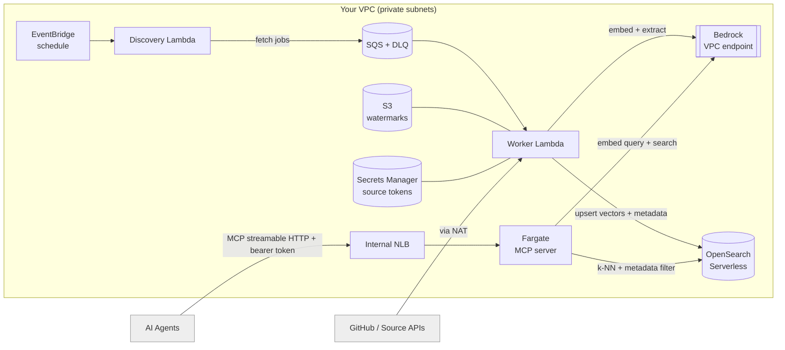
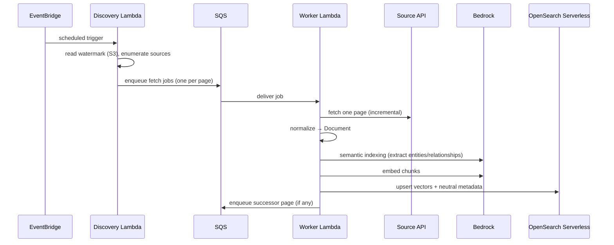

# Architecture

Aquifer is a **self-hosted engineering context layer**: infrastructure that aggregates
engineering context into a vector store and serves it, with evidence, to AI agents over MCP. It
is deployed as a **single AWS CDK (Python) stack** in your own account and VPC against your own
Amazon Bedrock. There is no external control plane. Outbound traffic is limited to HTTPS: to
GitHub for source content and to AWS services (see [security.md](./security.md#data-residency)).

This document describes the deployed architecture and the rationale behind it. It is written for
platform engineers and architects evaluating or operating Aquifer.

## High-level architecture

  

The diagram below is the source-of-truth schematic; the rendered version above mirrors it.

Every component is provisioned by one stack and lives in private subnets. Bedrock, OpenSearch,
SQS, Secrets Manager, and S3 are reached over VPC/PrivateLink endpoints; GitHub fetches, ECR
image pulls and CloudWatch Logs traverse a single NAT gateway (HTTPS only). The MCP load balancer
is **internal** and every request needs a bearer token — agents run inside the VPC or on a
private network listed in `mcp_allowed_cidrs` (VPN, peering).

## Stack composition

The stack (`infrastructure/aquifer_stack.py`) composes four constructs:

| Construct (`infrastructure/components/`) | Responsibility | Key AWS resources |
| --- | --- | --- |
| `network.py` | Private networking and egress control | VPC, NAT, interface endpoints (Bedrock, Secrets Manager, SQS), S3 gateway endpoint, per-role security groups (HTTPS-only egress) |
| `vector_store.py` | Neutral knowledge store | OpenSearch Serverless collection + VPC endpoint + encryption/network policies + least-privilege data-access policy (ingestion read/write, MCP read-only) |
| `ingestion.py` | Pull + index pipeline | Discovery & Worker Lambdas, EventBridge rule, SQS (+DLQ, alarm), S3 (watermarks), Secrets Manager (GitHub token) |
| `mcp_service.py` | Retrieval API | Fargate service (non-root, read-only FS), bearer-token secret, internal Network Load Balancer (optional TLS) |

Deploy-time configuration is validated by `infrastructure/stack_config.py` before synthesis.

## The pipeline

1. **Source → Document.** A `Connector` (e.g. GitHub) fetches READMEs, issues, PRs (newest
   first, incremental by watermark) and repository files (from one pinned commit of the default
   branch) one bounded page at a time, normalizing them into a source-agnostic `Document` with
   provenance (path, revision, timestamps, state). Pagination is fanned out through SQS so a full
   backfill is many short Lambda invocations. Unchanged files are skipped by git blob SHA before
   download.
2. **Skip unchanged.** The pipeline compares each document's content hash with the indexed
   generation and skips unchanged documents — no Bedrock calls on redelivery or overlap.
3. **Semantic Indexing.** In the `before_ingest` hook, deterministic parsers extract explicit
   references from Terraform, docker-compose and Backstage files; a Claude model on your Bedrock
   extracts relationships from prose, each checked against the text. See
   [concepts.md](./concepts.md#evidence-and-provenance).
4. **Chunk, embed, replace.** Chunks are exact source slices with line ranges, embedded with
   Amazon Titan. A new generation is written, then older generations are deleted (search +
   bulk delete by id — OpenSearch Serverless supports neither `_delete_by_query` nor custom ids
   on Classic vector collections), so a document is never missing mid-update.
5. **Reconcile.** Connectors report which documents still exist in a scope (a git tree, a README
   404); indexed documents that no longer exist are deleted. Discovery purges repositories
   removed from the allowlist.
6. **MCP API.** A Fargate service exposes the lake over the Model Context Protocol. Every tool
   call is authenticated, authorized through the interceptor seam, scoped to the configured
   repositories, and audit-logged.

**Failure handling.** Transient errors (throttling, timeouts, 5xx) are retried with bounded
backoff and then fail the page so SQS redelivers it; a permanently failing job lands in the DLQ
(alarmed). A permanent failure on one document is logged and counted while the rest of the page
and its successor pages continue. GitHub rate limits re-enqueue the job with an SQS delay
instead of consuming receives.

## Design rationale

**Modularity.** Every layer depends on a narrow interface, not a concrete implementation:
`Connector`, `Embedder`, `VectorStore`, `Inferencer`, `SemanticIndexer`, and `Interceptor`
(in `aquifer/core/interfaces.py`). Concrete adapters are selected at the edges via
`aquifer/ingestion/factory.py`. Adding a source, swapping the vector store, or changing the
embedding provider is a localized change — see [contributing.md](./contributing.md).

**Neutrality.** The engine extracts facts; it never draws conclusions, assigns risk, or returns
verdicts. This keeps Aquifer a trustworthy source of truth and leaves reasoning where it
belongs — in the agent. Neutrality is a hard architectural constraint, not a default.

**Security and sovereignty.** Model inference runs on your own Bedrock in the stack's region,
reached through a VPC endpoint. There is no Aquifer-operated API, no telemetry, and no license
server. The MCP endpoint is internal-only and requires a bearer token; source and MCP credentials
live in Secrets Manager; the OpenSearch collection is reachable solely through its VPC endpoint.
The full model and its limits: [security.md](./security.md).

**Right-sized compute.** Ingestion is bursty and IO-bound, so it runs on Lambda (serverless,
SQS-fanned). The MCP API holds long-lived agent connections, so it runs on Fargate. One stack,
two compute models, each matched to its workload.

## The extension seam

The core ships authentication (bearer tokens), a repository-scope guard and audit events. It also
exposes an `Interceptor` seam (`before/after_ingest`, `before/after_query`, `authorize`) that
receives the authenticated principal. Per-principal authorization, SSO-derived identities,
redaction or an external policy engine plug in there via configuration — the core never imports
the code that implements them.

---

**Support.** For commercial inquiries, professional advisory, or deployment support, contact
**[Senora.dev/contact](https://Senora.dev/contact)**. Aquifer.ai is an infrastructure layer you
run yourself, not a managed service.
