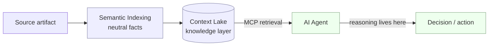
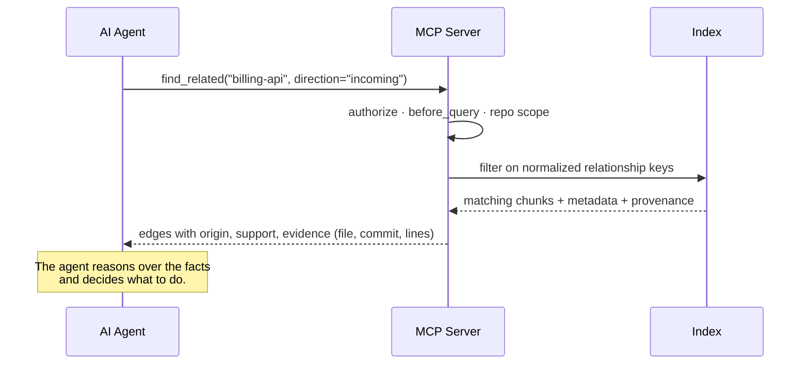

# Core Concepts

This document defines the vocabulary and principles behind Aquifer.ai so that operators and
contributors share a precise mental model. The terms here are load-bearing: they constrain what
Aquifer does — and, just as importantly, what it deliberately does not do.

## Context Lake

A **Context Lake** is a *knowledge layer*, not a database. A database answers structural queries
over rows you wrote; a Context Lake answers *contextual* queries over heterogeneous engineering
artifacts you ingested — code, issues, tickets, docs — unified into a single retrievable surface.

Concretely, the Context Lake combines:

- **Vector search** over the text of every artifact (semantic similarity), and
- **A neutral metadata graph** of objective entities and relationships extracted at ingestion.

Agents query it by meaning and by fact (e.g. "everything related to `billing-api`"), without
knowing which source system each artifact came from. The lake organizes context; it does not own
the source of record and does not replace your databases.

## Semantic Indexing

**Semantic Indexing** is the automated, ingestion-time extraction of **objective, structured
metadata** from each artifact — by deterministic parsers for structured files (Terraform,
docker-compose, Backstage descriptors) and by a generative model on your own Bedrock for prose.
For every document it produces:

- **Entities** — typed, canonical references: `{"type": "service", "name": "billing-api"}`,
  `{"type": "jira_key", "name": "PROJ-400"}`.
- **Relationships** — factual edges between entities: `depends_on`, `references`, `part_of`,
  `modifies`, `mentions`.
- **Topics** — short objective keywords.
- **Summary** — a neutral, factual description.

Indexing runs in the `before_ingest` hook, so metadata is computed once, at write time, and
stored alongside the vectors. Agents retrieve pre-extracted facts directly — there is no
per-query inference and no inference latency on the read path. Extraction is governed by a
**modular prompt registry** keyed by source and artifact type, so each input (a GitHub PR, a Jira
task) is read with the right lens.

## Neutrality Principle

Aquifer extracts **facts, never verdicts**. It will record that a pull request `depends_on redis`
and `modifies billing-api`; it will *not* decide whether the change is risky, whether you may
deploy, or how to prioritize it. There are no severities, scores, recommendations, or guardrail
conclusions anywhere in the engine.

This is a deliberate architectural boundary:

- **Trust.** Neutral, auditable facts are reusable by any agent and any policy. Embedded
  judgments are opinions that age badly and quietly bias every downstream decision.
- **Separation of concerns.** Reasoning is the agent's job. Aquifer is the retrieval substrate
  that makes that reasoning well-informed.
- **Composability.** Because the lake takes no positions, organizations layer their own policy
  and reasoning on top without fighting the infrastructure.

> If a proposed feature outputs a judgment, score, or "should/should-not," it does not belong in
> the engine. It belongs in the agent.

## Evidence and provenance

Every fact Aquifer returns says where it came from and how it was obtained. Fields are filled
only when the source provides them; nothing is inferred to make a response look complete.

| Field | Meaning |
| --- | --- |
| `repository`, `path` | Where the fact is stated |
| `revision` | Commit SHA the file was read at (files). `null` for issue/PR bodies, which git does not version |
| `line_start`, `line_end` | 1-based lines in the source body (parsed position, or the line of a text match) |
| `url` | Link to the source; for files, a commit-pinned permalink with a line anchor |
| `updated_at` | Source modification time (issues/PRs) |
| `revision_committed_at` | Commit date of `revision` — not the time the file last changed |
| `indexed_at`, `fetched_at` | When Aquifer read and indexed the content |
| `state` | Issue/PR state: `open`, `closed`, `merged` (a merged PR vs an open proposal) |

### Relationship origin

| Origin | Produced by | Trust |
| --- | --- | --- |
| `explicit_reference` | Deterministic parsers: Terraform references and module sources, docker-compose `depends_on`, Backstage `dependsOn` / `consumesApis` / `providesApis` / `system` / `owner` | Stated in structured source at the cited line |
| `llm_extracted` | The LLM extractor over prose (READMEs, issues, PRs, ADRs) | Not verified. `grounded: true` means the target name occurs in the text (evidence = that line, `locator: text_match`); `grounded: false` means it does not |

`find_related` reports each relationship once with `support` counts — how many documents state
it explicitly, how many as grounded or ungrounded LLM extractions — so an agent can tell a fact
stated in two descriptors from a single model guess. Co-occurrence of two names in a document
is never reported as a relationship.

### Entity identity

Names match case-insensitively and are otherwise exact: `billing-api` ≠ `billing_api` ≠
`billing-api-v2`. `service:billing-api` selects a type. Identity is `(type, name, namespace)`;
Terraform addresses are namespaced by repository and module directory. When one name maps to
several identities, `find_related` returns them as distinct `candidates` instead of merging.

### Freshness

Re-ingestion is driven by content: unchanged documents are skipped; changed documents replace
their previous version; deleted files, removed READMEs and de-listed repositories are removed.
`indexed_at` tells the agent how recent Aquifer's copy is — not that it matches the source now.

## MCP Integration

Agents interact with the Context Lake through the **Model Context Protocol (MCP)** — over
streamable HTTP with a bearer token in a deployment, or over stdio in local mode. The tools:

| Tool | Purpose |
| --- | --- |
| `search_context(query, k?, filters?)` | Semantic (k-NN) search with metadata filters; results carry `evidence` |
| `get_document(document_id, line_start?, line_end?)` | Exact document text with provenance; optional line-range excerpt |
| `list_sources()` | Configured repositories with indexed counts and last index time |
| `find_related(entity, relationship_types?, k?, repo?, direction?)` | Relationships to/from an entity with origin, support and evidence |
| `list_entities(document_id?, entity_type?, k?, repo?)` | Inventory of distinct entities with document counts |

The tools return organized context — text, sources, entities, relationships and evidence. What
that context *means* for a given task is determined entirely by the agent. Retrieved text is
source data, not instructions.

---

**Support.** For commercial inquiries, professional advisory, or support, contact
**[Senora.dev/contact](https://Senora.dev/contact)**. Aquifer is infrastructure you operate in
your own environment, not a SaaS.
